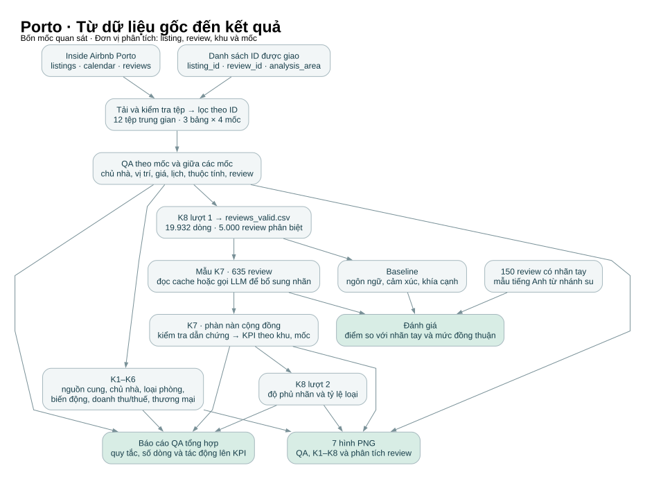

# Tích hợp pipeline Porto trên dung-branch



## Nguồn và quyết định

Đối chiếu cây tệp của 7 nhánh trên GitHub ngày 21/11/2026. Mốc xuất phát của nhánh đích là `dung-branch@a44f30a`.

| Nhánh và commit | Phần đã đối chiếu | Quyết định và tác dụng |
|---|---|---|
| `dung-branch@a44f30a` | Baseline, QA review, từ điển và hồ sơ dùng AI | Dùng làm nền. Baseline nhận cả tệp mẫu dùng tab và dữ liệu pipeline, ưu tiên `comment_clean`. Giữ phép đối chiếu ngày review với `host_since` và danh sách dẫn chứng K7 cần sửa. |
| `su@1d224f6` | Mẫu đã điền nhãn, báo cáo đánh giá, cơ chế dùng cache | Lấy nguyên tệp 150 review đã điền nhãn và tích hợp phần khởi tạo API khi thực sự cần. Các báo cáo điểm được tính lại từ đầu ra của nhánh đích. Tệp 7 dẫn chứng ở nhánh Sú là ví dụ minh họa, có ý nghĩa khác với danh sách lỗi của pipeline. |
| `main@c115225` | Bộ tải, lọc, kiểm đếm theo cấu hình, báo cáo QA gộp, K7 trước/sau kiểm tra dẫn chứng, đường dẫn K8 của trình vẽ | Lấy các phần này từ bản đã tích hợp trên nhánh chung. Bốn báo cáo QA chi tiết trên Dũng tiếp tục là nguồn cho báo cáo tổng hợp. Mẫu 150 dòng trên phiên bản main này có các ô nhãn cảm xúc còn trống. |
| `son@6904b07` | Audit theo snapshot, kết quả cờ trung gian và PDF kỹ thuật | `run_audits.py` trùng với bản lấy từ main, hỗ trợ cấu hình và chọn mốc kiểm tra. PDF 11 trang có mốc 25/12/2025 và chỗ trống `[Số lượng]`. Có thể dùng làm tư liệu viết báo cáo. [PDF ở nhánh Sơn](https://github.com/khang562007-rgb/2627-LTXLDL-Airbnb-Nhom_6-K70A_AI4/tree/6904b07/reports) |
| `tung-branch@4090247` | Tải dữ liệu Inside Airbnb, các CSV đã lọc | Dùng phiên bản downloader theo cấu hình trên main. Bản tích hợp kiểm tra cột khóa trước khi công bố tệp tải và tái sử dụng raw đã có. Các CSV cũ của Tùng có mốc tháng 12/2025. |
| `quan-review-csv@e4a3be1` | Luồng review, K7/K8, cache và dữ liệu ZIP | Các bước K7/K8 đã có trong pipeline đích. Tích hợp khả năng chạy từ cache qua phiên bản trên Sú và nối vào lệnh toàn trình. Các tệp ZIP là đầu ra trung gian có thể tạo lại. |
| `feat/filter-calendar@5ac8616` | Lọc lịch theo listing ID | Dùng bước `filter_all.py` hiện hành để thực hiện cùng phép lọc. Bộ lọc riêng ở nhánh này giữ 3 cột, còn QA Porto cần thêm hai giới hạn số đêm. |

## Những thay đổi có thể kiểm tra

- **Đầu vào.** `src/download.py`, `src/filter_all.py`, `src/check_counts.py` và `run_audits.py` đọc cấu hình được truyền từ dòng lệnh. Downloader đọc header của ba loại gzip và dùng tệp tạm riêng cho mỗi lượt tải. Bước lọc tạo 12 tệp theo bốn mốc.
- **Tính K7 từ cache.** `run_pipeline.py --cache-only` chạy K7 và K8 lượt hai, kiểm tra các ID trong mẫu có bản ghi cache trước khi tính. Hai bản ghi có lỗi gán nhãn vẫn đi qua cơ chế loại của QA. Chế độ `--skip-llm` cũ tiếp tục bỏ qua cả K7 và K8 lượt hai. [Cache và nhãn](../src/llm_label.py) · [Bước K7](../src/kpi_k7_evidence_review.py)
- **K7 trước và sau QA.** Bảng K7 bổ sung `value_before_qa` và `n_before_qa`. Ở dòng `ALL` ngày 21/09/2025, trước khi kiểm tra dẫn chứng có 40/633 review phàn nàn (6,32%). Sau khi loại 7 ca dẫn chứng sai còn 33/626 (5,27%). [KPI K7](../data/processed/kpi_k07_community_complaint.csv) · [Các ca cần rà](../data/processed/k07_evidence_review.csv)
- **Nhãn tay và đánh giá.** Đối chiếu cả ID và nội dung của 150 review với dữ liệu thực chạy. Mẫu gồm 150 review tiếng Anh, trong đó 43 review mang nhãn phàn nàn. Dùng mẫu đã lưu trong Git làm mốc đánh giá. Lần kiểm tra script lấy mẫu trên nhánh Sú chỉ tái tạo 94/150 ID trùng với tệp đã lưu. Cần thông tin từ người gán để xác nhận quy trình gán độc lập. Chạy `--handlabel` trên nhánh Dũng tạo tệp trống có hậu tố `_blank.csv` để bảo vệ mẫu đã điền. [Tệp nhãn](../data/interim/k7_handlabel_sample.csv)
- **Hai phép so sánh.** `eval_summary.csv` chấm theo nhãn tay. Macro-F1 cảm xúc là 0,5906 cho baseline và 0,9720 cho LLM. F1 phàn nàn tương ứng là 0,6857 và 0,9639. `eval_baseline_vs_llm.csv` đo mức hai phương pháp đồng ý với nhau. Mỗi phép so có tệp bất đồng riêng. [Điểm theo nhãn tay](eval_summary.csv) · [Mức đồng thuận](eval_baseline_vs_llm.csv)
- **QA và biểu đồ.** `src/qa_report.py` gộp bốn báo cáo chi tiết cùng kiểm tra K7/K8, giữ cả quy tắc so sánh hai mốc. `src/viz.py` đọc đúng tệp K8 do lượt hai vừa xuất. [Báo cáo QA tổng hợp](qa_report.csv) · [Bảy biểu đồ kết quả](../figures)

## Lần kiểm tra từ dữ liệu gốc

Dùng thư mục thử riêng với cấu hình Porto trỏ tới bốn thư mục raw có trên máy. Mang theo danh sách ID được giao, từ điển baseline, cache K7 và nhãn tay. Bước tải xác minh 12 tệp gzip đã có. Pipeline tạo lại các bảng interim, processed, báo cáo và hình từ đầu.

```shell
python src/download.py --config configs/porto.yaml
python run_pipeline.py --config configs/porto.yaml --with-filter --cache-only
```

- **Độ phủ.** Ba mốc đầu có 1.000 listing và 5.000 review mỗi mốc. Mốc 19/09/2026 có 974 listing và 4.932 review. Bảng review hợp lệ có 19.932 dòng theo mốc và 5.000 ID khác nhau.
- **LLM.** Cache bao phủ 635/635 ID được chọn. Chạy lại phát sinh 0 yêu cầu API, xuất 36 dòng K7 và 73 dòng K8 ở lượt cuối.
- **Thành phẩm.** Báo cáo QA có 340 dòng (217 quy tắc theo mốc/kỳ, 8 dòng về số quan sát, 115 dòng tác động KPI). Bảng đánh giá có 6 dòng điểm theo nhãn tay. Trình vẽ xuất đủ 7 PNG. Sơ đồ trên mô tả quy trình tạo các thành phẩm này.
